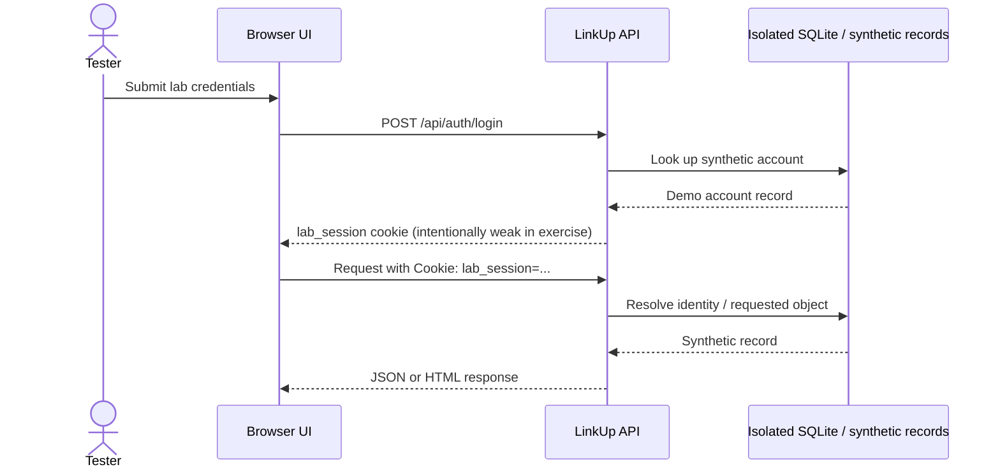

# LinkUp Web/API Pentest Plan, Application Map, and Deliverables

**Assessment team:** Ahmed Mohamed, Salah Ayman, Abdelrahman Ahmed, Abdelrahman Emad, and AbdAllah Osama<br>
**Review status:** The team will present this assessment for discussion and review. Reviewer feedback and any resulting retest outcomes will be recorded before the report is finalized.<br>
**Assessment date:** 15 October 2026<br>
**Target:** `http://127.0.0.1:3000` (interactive browser); isolated integration harness `http://127.0.0.1:3100`<br>
**Status:** Local lab run completed. This is a training assessment, not a production engagement.

## Scope and safety boundary

Only the LinkUp application bound to loopback and synthetic users/data is in scope. Do not direct the procedures at public hosts, real cloud metadata/services, host files, operating-system shell, production data, or perform denial-of-service/load testing. The SSRF endpoint resolves only to an in-process `mock.internal` service. File traversal and LFI read from a virtual catalog. Uploads remain in memory; command output is simulated; checkout has no payment processor.

## Application map

```text
Browser (feed, profiles, Creator Studio, lab directory, reflected-search page)
  ├─ Static UI: /, /labs.html, /lab/reflected
  └─ HTTP API on 127.0.0.1:3000
      ├─ Content: /api/feed, /api/posts, /api/posts/:id/comments, /api/search
      ├─ Identity: /api/auth/{register,login,me,logout}, /api/profile
      ├─ User objects: /api/users/:id, /api/users/:id/posts
      ├─ Admin: /api/admin/users, post/comment/like moderation routes
      └─ Practice exercises: /api/labs/{sql,auth-sqli,ssrf,upload,files,include,command,
                                      csrf/profile,jwt/*,shop/*}
```

The full method-by-method route list is in `LinkUp-Web-API-Pentest-Report.docx` Appendix A and in `LinkUp-API-collection.postman_collection.json`. The collection is an importable Postman-format request inventory; it is not a native Burp project file.

## Authentication and session flow



This diagram shows the lab behavior under test, including intentionally weak session validation. It is not a recommended design. Admin authorization is separately checked on moderation endpoints; a member receives 403 on the tested admin user-list route.

## Four-week project deliverables checklist

| Course week | Deliverable | Current artifact/status |
|---|---|---|
| 1: Fundamentals and Burp | Application map | This file + report Appendix A |
| 1 | Burp project and request/response inventory | Postman-format collection and field guide are ready to import/use; native `.burp` project not generated in this environment |
| 1 | Auth/session flow diagram | Mermaid diagram above |
| 1 | Test plan | This file and section below |
| 2: Input vulnerabilities | PoCs, payloads, evidence, CVSS, remediation | Report findings F01–F15; capture-required screenshot placeholders; field guide commands |
| 3: Auth/session/access/API | API request collection and findings | `artifacts/LinkUp-API-collection.postman_collection.json`; report Appendix A and F04/F05/F12/F13/F15 |
| 4: Chaining/report/retest | Attack chains, final report, retest, executive summary | Chains below; report Appendix C; report is evidence-backed draft pending screenshot capture/reviewer scoring |
| 4 | Demo walkthrough | Steps below |

## Test plan and run record

Test each endpoint manually with one variable changed at a time. Record method, path, query/body, authentication state, status, response evidence, and cleanup. Use synthetic identities only. The executed regression run was `npm test`: **36 local integration checks passed**. Browser checks separately confirmed reflected XSS and stored XSS with harmless visible markers and confirmed the CSRF state change; the profile was restored. The field guide distinguishes documented commands from tools actually executed. No broad fuzzing, password spraying, scanner run, external service, or load test is claimed.

1. Establish baseline health, feed, route map, test accounts, browser version, and a fresh/disposable database.
2. Map pages and API methods through the app and Burp Target/HTTP history. Import the supplied Postman collection if useful.
3. Validate each finding using the local-only field guide. Capture sanitized request and response plus browser effect as applicable.
4. Check access control with no cookie, a member session, and an admin session. Use only disposable posts/orders.
5. Run the documented cleanup: restore Alice's profile, delete temporary content/orders, stop local servers, and remove test-only databases.
6. For remediation retest, replay the same saved request and record Pass/Fail/Not Run with new evidence. Do not mark fixes as tested until a fresh request proves the expected secure result.

## Finding register and chaining map

| Findings | Exercise | Main chain use |
|---|---|---|
| F01 | Error-based / UNION / credential SQLi (synthetic DB) | Can expose or bypass synthetic identity logic |
| F02–F03 | Stored and reflected XSS | F02 joins weak session handling in Chain A |
| F04 | Weak password/session and no login throttling | Chain A and Chain C |
| F05 | Profile IDOR/private field exposure | Chain B |
| F06 | Open redirect | Standalone trust/phishing pattern |
| F07–F11 | Mock SSRF, volatile upload, virtual traversal/LFI, simulated command injection | Contained exercises only; no real infrastructure access |
| F12 | CSRF through state-changing GET | Chain E |
| F13 | Unsigned JWT claim trust | Chain D |
| F14–F15 | Client-controlled price and order BOLA | Chain D |

### Chain A — stored XSS + weak session → privileged action (lab-only)

Use a harmless visible script marker in a disposable post. Verify it executes in the local feed, then show that the training session token is script-readable/predictable without exporting it. Demonstrate the consequence only with the synthetic accounts and one reversible admin moderation action. Capture each link independently, then remove the test post/comment. Never steal or transmit a cookie.

### Chain B — profile IDOR → related synthetic content

Read a second synthetic user's profile without authentication, then request that user's posts. Show the data exposure using synthetic fields only. Do not enumerate IDs beyond the seeded examples or export records.

### Chain C — weak session → role gate validation

Compare unauthenticated, member, and admin requests to one admin route. Capture actual status and side effect. Confirm the admin can do the authorized moderation task and that member access is rejected. Delete any test object.

### Chain D — unsigned JWT + checkout tampering + order BOLA

Issue a synthetic JWT, modify its claims locally, and demonstrate that the lab verifier accepts the altered role/subject/expired token. Separately create a disposable synthetic order with a changed client price, read it without a session, and delete it. The combined story illustrates identity-claim trust and business/object authorization weaknesses; it involves no real payment or customer information.

### Chain E — cross-origin same-site CSRF → profile change

With Alice authenticated, visit the supplied PoC served from loopback port 3001. Capture the browser's state-changing request and resulting synthetic profile update. Restore Alice's original bio and verify restoration. Record browser/cookie behavior exactly as observed.

## Demo walkthrough (about 5 minutes)

1. Show the lab directory and scope statement; confirm health reports contained mock mode.
2. In Burp, show the scoped localhost Target tree and representative API history. Do not expose raw credentials or cookies in screenshots.
3. Demonstrate one input issue (SQL error response), one browser issue (harmless XSS marker), and one access-control issue (synthetic IDOR or member/admin comparison).
4. Demonstrate one chained path, preferably CSRF→profile change or synthetic JWT→order lookup, including cleanup.
5. Show the report's finding, impact caveat, remediation, evidence placeholder, and retest steps. Explicitly identify which tools were run versus merely documented.

## Evidence and screenshot instructions

Screenshot IDs S-01–S-16 are in the report. Empty boxes are deliberate capture slots, not captured evidence. Use Win+Shift+S to capture a cropped Burp Repeater/Proxy or browser DevTools view with the relevant request and response visible. Capture the endpoint/status/impact marker; redact passwords, session tokens, unrelated tabs, and personal information. Follow each screenshot caption in the report for setup and cleanup instructions. Add filename and page number to the screenshot register after inserting the image.

## Retest checklist

- [ ] SQL values use parameters; syntax errors are generic; login bypass/UNION proof no longer works.
- [ ] Stored and reflected content is contextually encoded/sanitized; harmless marker renders as text.
- [ ] Login uses modern password hashing, throttling, and generic failures; sessions are random, HttpOnly, Secure, appropriately SameSite, rotated, and invalidated.
- [ ] Private profile and order objects require authentication and ownership checks.
- [ ] Redirect destinations are allowlisted local routes.
- [ ] CSRF mutation uses POST plus anti-CSRF validation and rejects the PoC request.
- [ ] JWT signature, allowed algorithm, issuer/audience, and time claims are enforced.
- [ ] Checkout price/totals derive server-side from product IDs and valid quantities.
- [ ] SSRF remains mock-only; upload validation/storage is safe; file/template paths are constrained; no shell executes user input.
- [ ] Admin actions remain usable to admin and denied to members.
- [ ] Temporary records and test database are removed; report records retest date, result, and fresh evidence.
